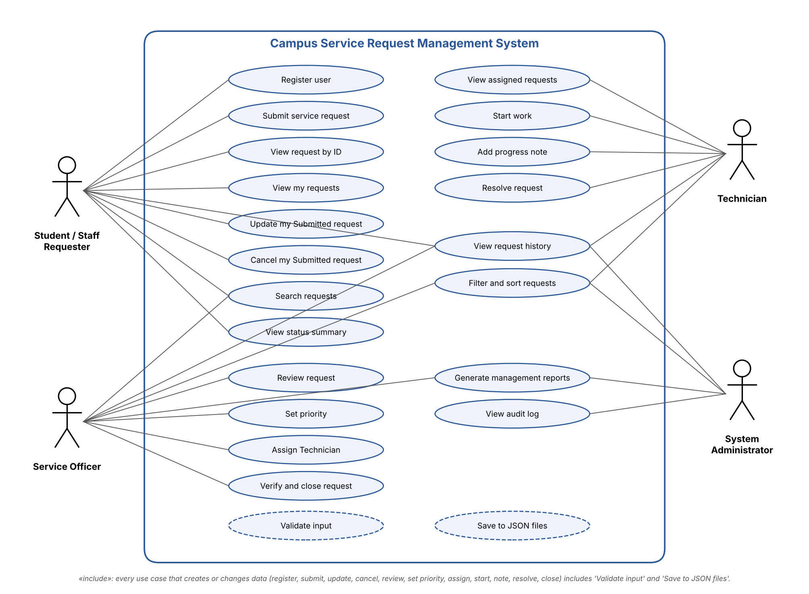
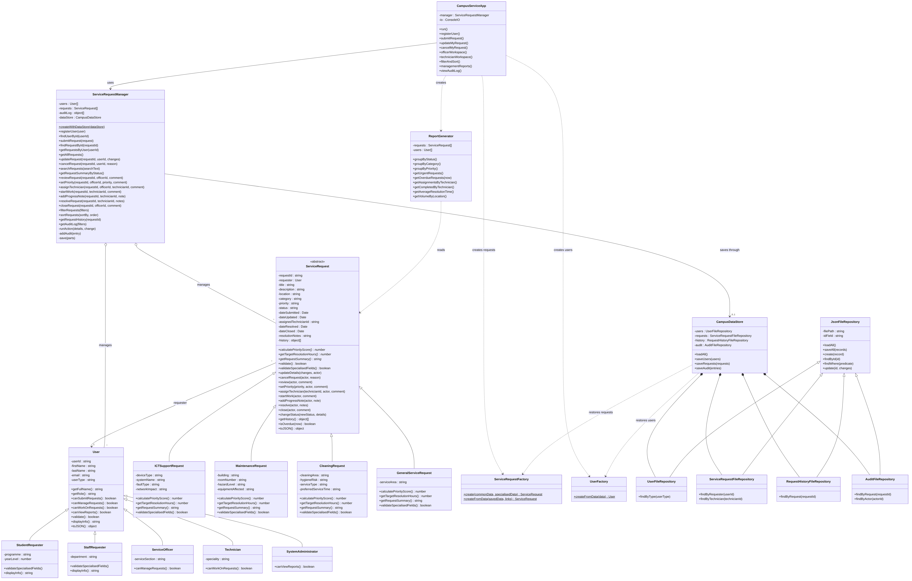
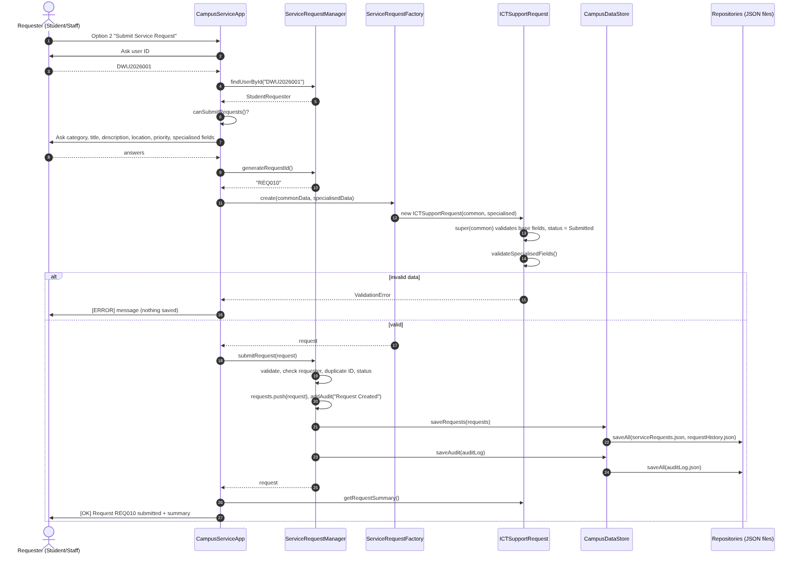
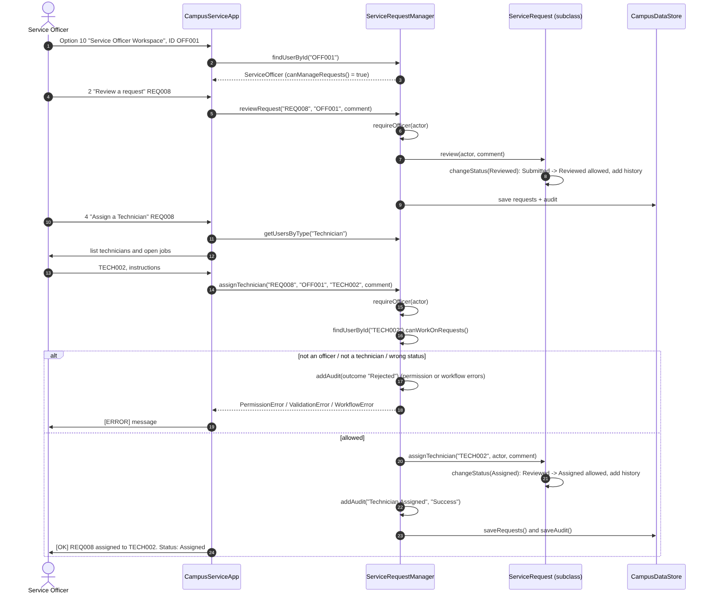
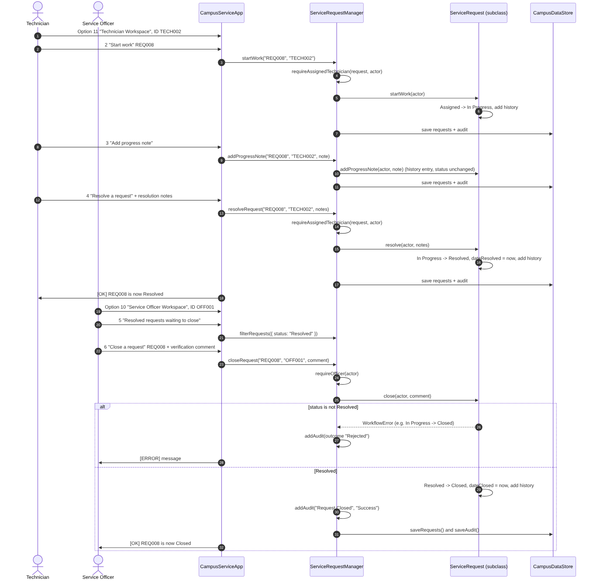
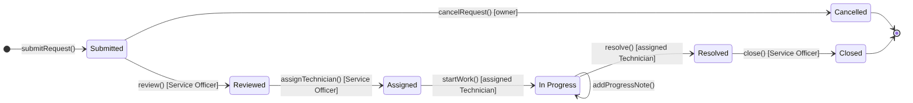

# UML and System Design
## Campus Service Request Management System

**Student:** [Student Name] – [Student ID]

All diagrams below were drawn from the final submitted code. The editable sources are in `docs/uml/` (`.mmd` files are Mermaid, `use_case_diagram.py` draws the use case diagram).

---

## 1. Use Case Diagram

Four actors use the system. Requesters (students and staff) create and follow their own requests. The Service Officer controls the middle of the workflow: review, priority, assignment and closure. The Technician does the work. The System Administrator only reads: history, audit log and reports. Every use case that creates or changes data includes input validation and saving to the JSON files.

## 2. Class Diagram

The full-resolution image is `docs/uml/class_diagram.png` (zoom in to read every member).

Notation: `-` private field (JavaScript `#` field), `+` public method, *italic* (`*`) abstract-style method, underlined (`$`) static method. Hollow triangle = inheritance, filled diamond = composition, hollow diamond = aggregation, dashed arrow = dependency ("creates" or "uses").

## 3. Sequence Diagram – Submitting a Request

## 4. Sequence Diagram – Assigning a Technician

## 5. Sequence Diagram – Resolving and Closing a Request

---

## 6. Explanation of the Class Relationships

**Inheritance (is-a).**

- `User` is the base class for `StudentRequester`, `StaffRequester`, `ServiceOfficer`, `Technician` and `SystemAdministrator`. Each subclass calls `super()` and adds its own field (programme and year level, department, service section, speciality). They override `canSubmitRequests()`, `canManageRequests()`, `canWorkOnRequests()` and `canViewReports()`, so the manager asks the object what it is allowed to do instead of checking type names.
- `ServiceRequest` is an abstract-style base class for `ICTSupportRequest`, `MaintenanceRequest`, `CleaningRequest` and `GeneralServiceRequest`. It cannot be created directly. Each subclass calls `super(commonRequestData)` and overrides `calculatePriorityScore()`, `getTargetResolutionHours()`, `getRequestSummary()` and `validateSpecialisedFields()`.
- `JsonFileRepository` is the base class for the four file repositories. It holds the shared `loadAll`, `saveAll`, `create`, `findById` and `update` logic; subclasses add finders such as `findByRequester()` and `findByTechnician()`.

**Association.** Each `ServiceRequest` holds a reference to exactly one `User` object as its requester (many requests to one user). The assigned Technician is stored as an ID, because the Technician may change role data independently and the ID is what gets saved to JSON.

**Aggregation.** `ServiceRequestManager` keeps arrays of `User` and `ServiceRequest` objects. The objects can exist without the manager (they are created by the factories and tested on their own), so this is aggregation rather than composition.

**Composition.** `CampusDataStore` creates and owns its four repositories; they are not shared and exist only inside it. Each `ServiceRequest` also owns its history array, which is only reachable through `getHistory()` (a copy).

**Dependency.**

- `CampusServiceApp` uses the manager for every action, and uses `UserFactory`, `ServiceRequestFactory` and `ReportGenerator`. It never touches the repositories or files.
- `CampusDataStore` uses `UserFactory` and `ServiceRequestFactory` to turn plain JSON records back into real objects.
- `ReportGenerator` reads requests and users to produce reports.

**Layers.** The design keeps four layers apart:

| Layer | Classes | Knows about |
|---|---|---|
| Presentation | `CampusServiceApp`, `ConsoleIO` | Manager, factories, reports |
| Application / control | `ServiceRequestManager`, `ReportGenerator` | Domain objects, data store interface |
| Domain | `User` + subclasses, `ServiceRequest` + subclasses | Constants and errors only |
| Persistence | `CampusDataStore`, repositories, factories | Domain objects, `fs/promises` |

## 7. Request Status State Model

The allowed moves are stored in one table, `ALLOWED_TRANSITIONS` in `src/constants.js`, and checked in one method, `ServiceRequest.changeStatus()`. Who may trigger each move is checked by `ServiceRequestManager` before the request method is called.
