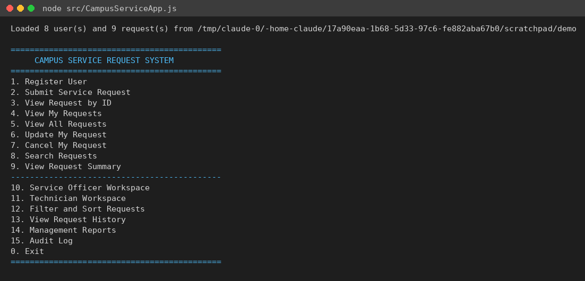
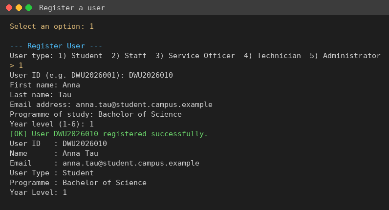
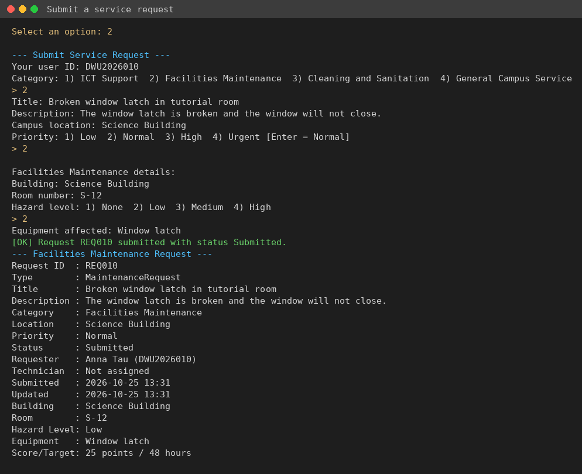
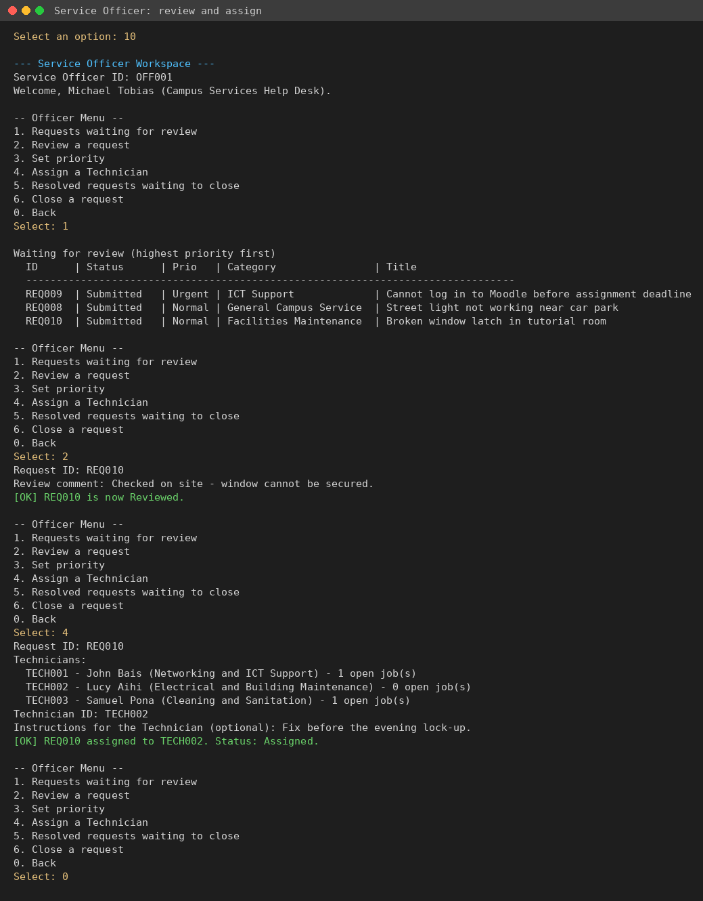
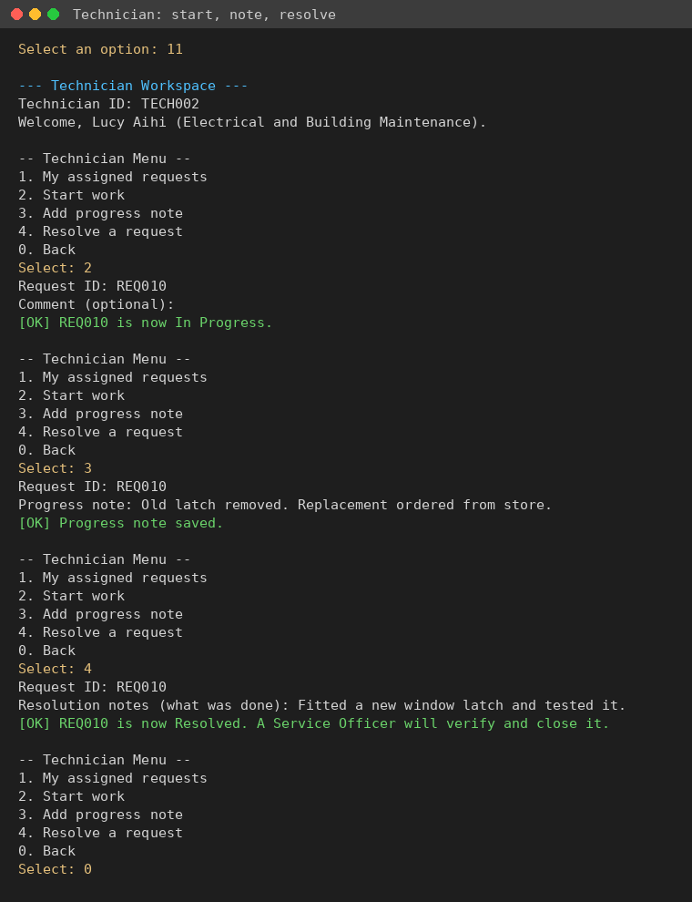
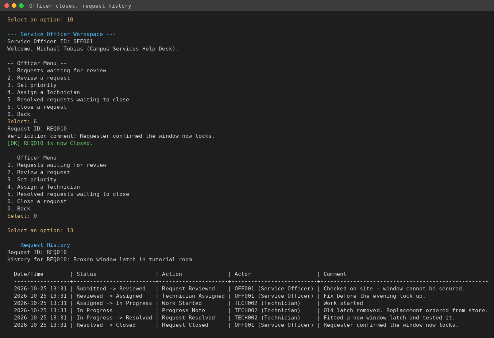
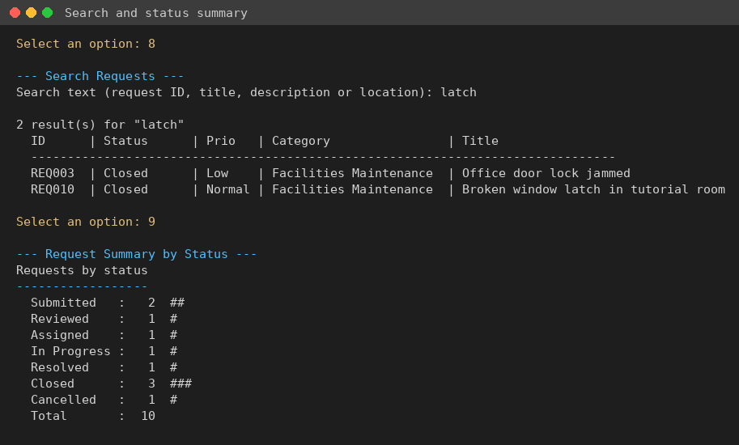
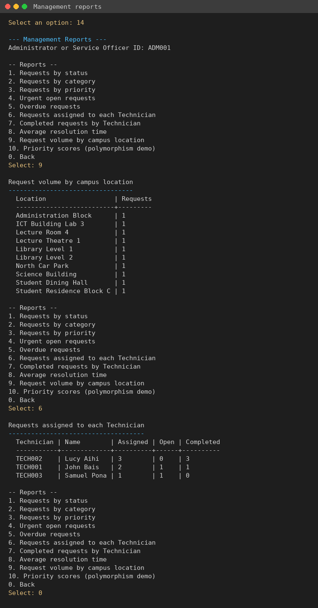
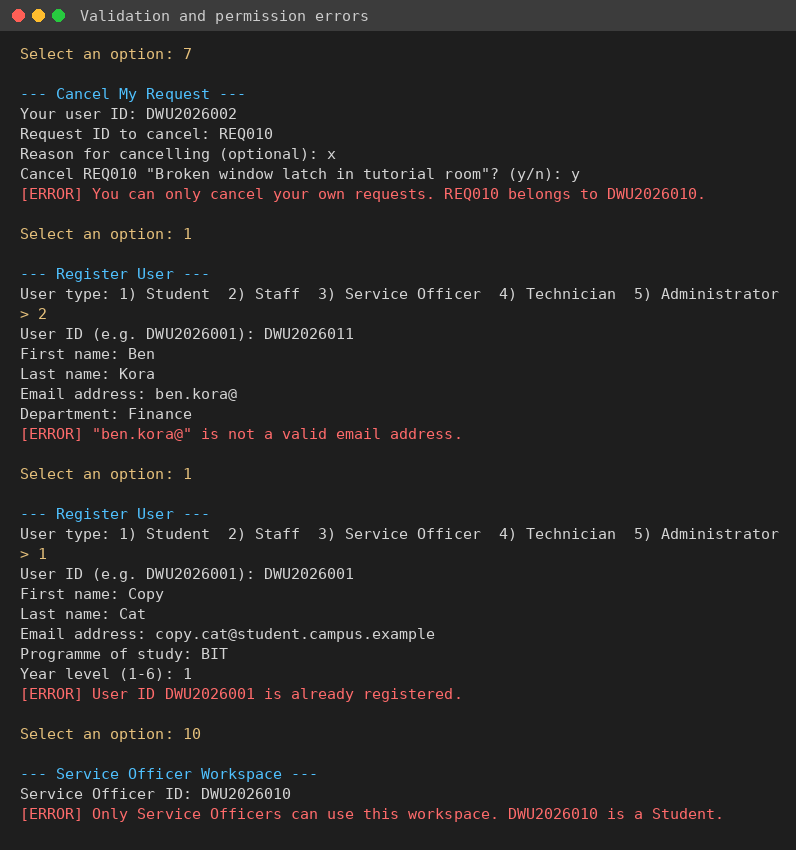

# User Guide
## Campus Service Request Management System

**Student:** [Student Name] – [Student ID]

---

## 1. Installation Requirements

- **Node.js 20 or later** (tested on Node.js 22). Check with `node --version`.
- npm (installed with Node.js).
- Any terminal: Command Prompt, PowerShell, macOS Terminal or a Linux shell.
- No database and no extra npm packages are needed.

## 2. Setup Instructions

1. Unzip the submission (or clone the repository) and open a terminal in the `AT3_CampusServiceRequestSystem` folder.
2. Run `npm install`. There are no dependencies, so this only creates `package-lock.json`.
3. (Optional) Run `npm run seed` to reset the `data/` folder to the demonstration records. **This deletes any data you have added.**

The demonstration data contains these simulated users:

| User ID | Name | Role |
|---|---|---|
| DWU2026001 | Grace Kila | Student |
| DWU2026002 | Peter Wama | Student |
| STF1001 | Ruth Kaupa | Staff |
| OFF001 | Michael Tobias | Service Officer |
| TECH001 | John Bais | Technician (Networking and ICT) |
| TECH002 | Lucy Aihi | Technician (Electrical and Building) |
| TECH003 | Samuel Pona | Technician (Cleaning and Sanitation) |
| ADM001 | Helen Morobe | System Administrator |

and nine requests (REQ001–REQ009) at different stages of the workflow.

## 3. Starting the Application

```
node src/CampusServiceApp.js
```

or `npm start`. The program loads the data files and shows the main menu. Type a number and press Enter.



Options 1–9 are the core requester features. Options 10–15 were added for the workflow, reports and audit. Option 0 exits; data is saved after every change, so nothing is lost when you exit.

To use a different data folder (for example a copy for practice), set `CAMPUS_DATA_DIR`:

```
# macOS / Linux
CAMPUS_DATA_DIR=./practice-data node src/CampusServiceApp.js
# Windows PowerShell
$env:CAMPUS_DATA_DIR="practice-data"; node src/CampusServiceApp.js
```

## 4. Registering or Selecting a User

There are no passwords. You "select" yourself by typing your user ID whenever the program asks.

To register, choose **1. Register User**, pick the user type, then answer the questions. Each type asks for one or two extra details (programme and year for students, department for staff, section for officers, speciality for Technicians).



## 5. Submitting a Request

Choose **2. Submit Service Request**:

1. Enter your user ID (must be a Student or Staff account).
2. Choose the category by number.
3. Enter the title, description and campus location.
4. Choose a priority (press Enter for Normal).
5. Answer the category-specific questions (for example building, room and hazard level for maintenance).

The system gives the request the next ID and shows its full summary, including the priority score and target resolution time.



You can then use **3. View Request by ID** or **4. View My Requests** to follow it. **6. Update My Request** lets you change details while it is still Submitted (press Enter to keep a value), and **7. Cancel My Request** cancels it.

## 6. Assigning and Processing a Request

### 6.1 Service Officer – review and assign

Choose **10. Service Officer Workspace** and enter an officer ID (e.g. OFF001).

- **1** lists Submitted requests, most urgent first.
- **2** reviews a request (Submitted → Reviewed).
- **3** changes the priority.
- **4** assigns a Technician (Reviewed → Assigned). The list shows each Technician's speciality and current open jobs.



### 6.2 Technician – work and resolve

Choose **11. Technician Workspace** and enter a Technician ID.

- **1** lists your assigned requests.
- **2** starts work (Assigned → In Progress).
- **3** adds a progress note (status stays In Progress).
- **4** resolves the request with notes on what was done (In Progress → Resolved).



### 6.3 Service Officer – verify and close

Back in the officer workspace, **5** lists Resolved requests and **6** closes one after checking (Resolved → Closed). **13. View Request History** shows every step.



## 7. Searching, Filtering and Reports

- **8. Search Requests** – type part of a request ID, title, description or location.
- **9. View Request Summary** – count of requests for each status.
- **12. Filter and Sort Requests** – optional filters for category, status, priority and Technician, then sort by date submitted or priority, ascending or descending.



- **14. Management Reports** (Administrator or Service Officer): status, category and priority counts, urgent requests, overdue requests, Technician workload, completed jobs per Technician, average resolution time, volume by location, and a priority score table that shows polymorphism.
- **15. Audit Log** (Administrator only): every action, who did it, when and whether it succeeded or was rejected. You can filter by request ID.



## 8. Common Errors and Solutions



| Message | Cause | Solution |
|---|---|---|
| `No user is registered with ID ...` | ID typed wrongly or not registered | Check the ID (not case-sensitive) or register with option 1. |
| `User ID ... is already registered.` | Duplicate user ID | Use a different ID, or use the existing account. |
| `"..." is not a valid email address.` | Email missing `@` or domain | Enter an address like `name@campus.example`. |
| `Request title is required.` | Empty title/description/location | Fill in every field. |
| `"..." is not one of the listed options.` | Typed a value not in the list | Type the number shown, or the exact name. Three attempts are allowed. |
| `You can only update/cancel your own requests.` | Another user's ID was entered | Enter the requester's own ID. |
| `Only Submitted requests can be updated/cancelled.` | The request has already been reviewed | Ask the Service Officer to make the change. |
| `Request ... is already Cancelled.` | Cancelled twice | No action needed. |
| `Only a Service Officer can ...` / `Only Service Officers can use this workspace.` | Wrong role | Use an officer ID such as OFF001. |
| `Only the assigned Technician (TECHxxx) can ...` | A different Technician tried to work on the job | Log in as the assigned Technician, or ask the officer. |
| `Invalid status change for REQxxx: A -> B. Allowed next status: ...` | A step was skipped (e.g. closing before resolving) | Do the next allowed step shown in the message. |
| `The data files could not be loaded. users.json does not contain valid JSON` | A data file was edited by hand and broken | Fix the file, or delete it (an empty one is created), or run `npm run seed`. |
| `File error: Could not write ...` | No permission to write the data folder, or disk full | Check folder permissions and free space, then try again. |
| `[WARNING] Skipped request ...` | One record in a file is invalid | The rest of the data loaded. Fix or remove that record. |
